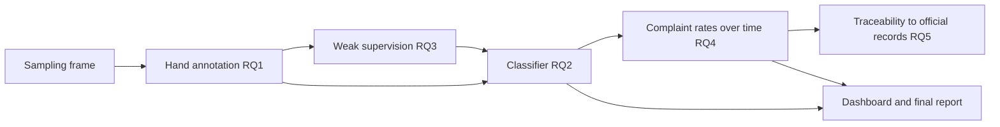

# Six-week roadmap: AI-driven cosmetic product safety intelligence

Primary problem: early detection of safety complaints in online beauty reviews. Product matching, variant attributes, semantic retrieval and batch traceability are kept as exploratory work or future extensions.

| | |
|---|---|
| Programme | YuvaIntern, Data Science with Python Analyst (Beauty and Wellness) |
| Duration | 25 September 2026 to 6 November 2026, six weeks, 30 to 35 hours each |
| Weekly deliverable | One Word report (.docx), the GitHub URL, and a description of at least 200 words |
| Repository | https://github.com/Pawansingh3889/yuvaintern |
| Roadmap first written | 11 October 2026 |
| Last revised | 11 October 2026: complaint detection made the primary problem; dataset feasibility checkpoint and annotation milestones added |

## Contents

1. [Project in one page](#1-project-in-one-page)
2. [Research questions and areas](#2-research-questions-and-areas)
3. [Schedule and current position](#3-schedule-and-current-position)
4. [Milestones](#4-milestones)
5. [Dataset feasibility checkpoint](#5-dataset-feasibility-checkpoint)
6. [Datasets](#6-datasets)
7. [Week 1: problem definition](#week-1-problem-definition-research-and-documentation)
8. [Week 2: data sourcing and feasibility](#week-2-data-sourcing-feasibility-checkpoint-and-annotation-pilot)
9. [Week 3: cleaning and first labels](#week-3-cleaning-pipeline-and-first-annotation-round)
10. [Week 4: annotation milestone, EDA, weak supervision](#week-4-annotation-milestone-eda-features-and-weak-supervision)
11. [Week 5: modelling](#week-5-predictive-modelling-and-algorithm-selection)
12. [Week 6: evaluation and communication](#week-6-evaluation-dashboard-and-business-communication)
13. [Repository structure](#repository-structure)
14. [Risks and mitigations](#risks-and-mitigations)
15. [Final checklist](#final-checklist)

## 1. Project in one page

**Business problem.** Shoppers describe rashes, burning, spoiled and contaminated products in public reviews. Brands and retailers have no reliable way to separate those few genuine safety complaints from millions of ordinary comments, so a bad batch can keep selling until formal complaints build up.

**What the project delivers.**

- A labelled set of 500 to 1,000 beauty reviews marked for safety complaints, with measured annotator agreement.
- A cleaning pipeline for review text and product metadata.
- A tested comparison of a keyword baseline, supervised classifiers and a weakly supervised model.
- A descriptive study of complaint rates before recalls, and a small dashboard that ranks flagged reviews for a person to read.

**What the project does not claim.** It does not certify a product safe or unsafe, estimate injury rates, prove that a product caused a reaction, or predict recalls. Every flag is a prompt for a person to investigate.

**Ordering rule.** Labelling and weak supervision come before modelling. No model is evaluated on anything except hand labels.

## 2. Research questions and areas

| RQ | Question | Hypothesis | Status | Evaluated in |
|---|---|---|---|---|
| RQ1 | Can people label safety complaints consistently? | H1: Cohen's kappa of at least 0.70 on 200 double-labelled reviews | Core | Weeks 2 to 4 |
| RQ2 | Does a classifier detect complaints better than a keyword search? | H2: higher average precision than the keyword baseline on held-out labels | Core | Weeks 5 and 6 |
| RQ3 | Can weak supervision reduce hand labelling? | H3: F1 within 0.05 of a model trained on hand labels | Core | Weeks 4 to 6 |
| RQ4 | Do complaint rates rise before a recall? | H4: higher rate in the 12 months before recall, for microbial but not benzene recalls | Exploratory | Weeks 5 and 6 |
| RQ5 | Can a flagged product be traced to the right official record? | H5: brand and size matching beats name-only matching | Exploratory | Week 6 summary |

The five research areas of the wider project:

| Research area | Priority | Linked RQ |
|---|---|---|
| Early safety-complaint detection | Primary | RQ1 to RQ4 |
| Product identity matching | Exploratory | RQ5 |
| Variant attributes (size, formulation) | Exploratory | RQ5 |
| Semantic retrieval with language models | Future extension | RQ5 |
| Batch traceability and explanation | Future extension | RQ5 |



## 3. Schedule and current position

Nominal weeks run from the 25 September start. The YuvaIntern task page shows no per-week deadline, only the end date. Confirm on the platform whether late weekly submissions are accepted.

| Week | Nominal dates | Status on 11 October 2026 | Catch-up target |
|---|---|---|---|
| 1 | 25 September to 1 October | Submitted 11 October, scored 52.2 of 100; report revised on 13 October against the feedback; resubmission pending | Resubmit 13 October |
| 2 | 2 to 8 October | Notebook built and run: register, fingerprints, source profiles, counts, pilot sample drawn. Pilot labelling and the Word report pending | 17 October |
| 3 | 9 to 15 October | Not started | 22 October |
| 4 | 16 to 22 October | Not started | 27 October |
| 5 | 23 to 29 October | Not started | 1 November |
| 6 | 30 October to 5 November | Not started | 5 November |

The project is about ten days behind the nominal calendar. The catch-up targets need roughly 6.5 hours a day. If that is not available, cut scope in this order: the optional sentence encoder (5.6), dashboard extras, then RQ5. Do not cut annotation, agreement checks or the error audit.

## 4. Milestones

| ID | Milestone | Week | Measurable output | Depends on | Status |
|---|---|---|---|---|---|
| M1 | Problem defined and submitted | 1 | Week 1 .docx uploaded with repository URL | None | Revised report ready; resubmission pending |
| M2 | Source register complete | 2 | At least 8 sources, each with licence, access, frequency and limits | M1 | 11 sources in the notebook and `dataset_sources.md` |
| M3 | **Dataset feasibility checkpoint** | 2 | Written go or no-go against criteria F1 to F6 | M2 | F1, F2 met; F6 not met; F3 to F5 pending |
| M4 | **Annotation pilot** | 2 | Guideline draft; 50 reviews double-labelled; kappa reported | M3 | Guideline drafted and sample drawn; no labels yet |
| M5 | Cleaning pipeline reproducible | 3 | One command rebuilds `data/processed`; tests pass | M2 | Not started |
| M6 | **Annotation milestone** | 4 | 500 labels minimum, 1,000 target; 200 double-labelled; kappa at least 0.70 or a documented shortfall; set frozen and hashed | M4, M5 | Not started |
| M7 | Weak supervision measured | 4 | Each labelling function scored against development labels | M6 | Not started |
| M8 | Models compared | 5 | Keyword baseline and at least two models on the same development splits | M6, M7 | Not started |
| M9 | Final evaluation and error audit | 6 | Metrics with intervals from one run on the frozen test set; error taxonomy | M8 | Not started |
| M10 | Dashboard and final report | 6 | `app.py` runs locally; Week 6 .docx uploaded | M9 | Not started |

## 5. Dataset feasibility checkpoint

Decided at the end of Week 2. Criteria fixed on 11 October 2026. Detail and evidence tables are in `research_feasibility_matrix.md`.

| ID | Criterion | Threshold | Observed | Status |
|---|---|---|---|---|
| F1 | Dated beauty reviews with text, held locally | At least 500,000 | 23,874,796 | Met |
| F2 | Keyword-enriched pool to sample from | At least 5,000 | 614,203 | Met |
| F3 | Genuine complaints among keyword hits | At least 10% in the labelled pilot | About 22% (13 of 60), informal single-reader check | Provisional |
| F4 | Annotator agreement in the 50-review pilot | Kappa at least 0.60 | Not yet run | Pending |
| F5 | Expected positives in the 1,000 sample | At least 100 | Roughly 120 to 160 if F3 holds | Provisional |
| F6 | Recalled lines with at least 20 reviews in the 12 months before recall | At least 20 | 8 of 40 | Not met |

- F1 to F5 decide the core study. If F3 or F4 fails in the pilot, revise the guideline and keyword lists and repeat the pilot once.
- F6 decides RQ4. It is not met, so RQ4 is a descriptive comparison and a case study. No model of recalls is built.

The counts were first made with one-off scripts on 11 October 2026 and reproduced exactly by `complaint_detection.ipynb` on 13 October 2026.

## 6. Datasets

Full details, fields and limits are in `dataset_sources.md`.

| Source | Role | Size and coverage | Access and licence | Status |
|---|---|---|---|---|
| [Amazon Reviews 2023](https://amazon-reviews-2023.github.io/), Beauty and Personal Care | Review text for RQ1 to RQ4 | 23,911,390 reviews; 1,028,914 products; to September 2023 | Open download; no licence stated | In `data/raw/amazon_reviews_2023` |
| [openFDA cosmetic adverse events](https://open.fda.gov/apis/cosmetic/event/) | Reaction vocabulary for labelling functions | 85,511 reports; last updated August 2025 | Open API and bulk file | In `data/raw/openfda` |
| [FDA cosmetics adverse event dashboard](https://www.fda.gov/news-events/press-announcements/fda-launches-real-time-adverse-event-reporting-dashboard-cosmetic-products) | Current official reports, context | Updated daily | Dashboard download | Not downloaded |
| [Health Canada recalls feed](https://open.canada.ca/data/en/dataset/d38de914-c94c-429b-8ab1-8776c31643e3) | Recall dates for RQ4 | 34,212 records; 201 beauty; 93 from 2012 to September 2023 | Open JSON; Open Government Licence, Canada | In `data/raw/health_canada` |
| [openFDA drug enforcement](https://open.fda.gov/apis/drug/enforcement/) | Recall dates for RQ4 | 18,010 records; 74 benzene recalls from 2020 to September 2023 | Open API and bulk file | In `data/raw/openfda` |
| [FDA Data Dashboard recalls](https://datadashboard.fda.gov/oii/cd/recalls.htm) | US cosmetics recalls for RQ4 | Not measured | Dashboard download | Not downloaded |
| [RappelConso V2](https://www.data.gouv.fr/datasets/rappelconso-v2-rappels-de-produits) | Official notices for RQ5 | 296 cosmetic notices retained | French Open Licence 2.0 | In `data/raw`, used in notebook |
| [Open Beauty Facts](https://www.data.gouv.fr/datasets/open-beauty-facts) | Product catalogue for RQ5 | 64,237 records | ODbL | In `data/raw`, used in notebook |
| [EU Safety Gate 2025 report](https://op.europa.eu/webpub/just/safety-gate-2025-report/en/) | Sector context | Aggregate | Public web report | Read online |
| [UK Product Safety Database reports](https://www.gov.uk/government/statistics/product-safety-database-annual-reports) | Sector context | Aggregate | Open Government Licence | In `data/raw` |
| [Sephora reviews, Kaggle](https://www.kaggle.com/datasets/nadyinky/sephora-products-and-skincare-reviews) | Rejected | 8,494 products | Kaggle | Documented negative result |

**Evidence from earlier scoping** (notebook `cosmetic_recall_analysis.ipynb`, snapshots of 2 October 2026). This work predates the change of primary problem and now informs RQ5 only.

| Finding | Value |
|---|---|
| French cosmetic recall notices retained | 296 |
| Product identities linked by barcode | 30, across 22 notices |
| Linked identities with usable names | 17 (9 development, 8 evaluation) |
| Word TF-IDF, linked notice ranked first | 6 of 8 |
| Character TF-IDF, linked notice ranked first | 5 of 8 |
| Concrete failure | Both methods rank a 300 ml Activilong recall above the barcode-linked 250 ml recall |

**Recall overlap probe**, 11 October 2026, 40 recalled product lines picked by hand, title matching only, unreviewed:

| Measure | Product lines, of 40 |
|---|---|
| At least one title match in the Amazon catalogue | 27 |
| At least 1 review dated before the recall | 23 |
| At least 20 reviews dated before the recall | 14 |
| At least 20 reviews in the 12 months before the recall | 8 |
| At least 100 reviews in the 12 months before the recall | 3 |

Of the 12 microbial or mould lines, only Bioderma Sensibio H2O has volume (3,016 earlier reviews); the next is Method hand wash with 23.

## Week 1: problem definition, research and documentation

**Rule for this week: no model training and no project code.** Feasibility counts were made with throwaway scripts to check that the plan is realistic. They are descriptive counts, not model results.

**Objectives**

- Define one business problem in beauty and wellness that data science can address.
- Support it with industry trends from 2023 to 2026 and academic research.
- State research questions, hypotheses, variables, datasets, methodology, an annotation strategy and limitations.

**Tasks**

| ID | Task | Hours | Depends on | Acceptance criteria | Evidence |
|---|---|---|---|---|---|
| 1.1 | Industry trend research, 2023 to 2026 | 6 | None | At least 8 dated industry or regulatory sources | 9 in `references.md` |
| 1.2 | Academic research on review-based safety signals, weak supervision and agreement | 5 | None | At least 8 academic sources with verified details | 10 in `references.md`, checked against Crossref and arXiv |
| 1.3 | Dataset identification with official links | 5 | 1.1 | Every dataset has owner, URL, licence and limits | `dataset_sources.md` |
| 1.4 | Feasibility counts on candidate data | 5 | 1.3 | Counts recorded with their limits | `research_feasibility_matrix.md` |
| 1.5 | Problem statement, five questions, hypotheses, variables, methodology | 6 | 1.1 to 1.4 | Each hypothesis names its measure and decision rule | Report sections 2, 4, 5 and 8 |
| 1.6 | Annotation strategy, ethics and limitations | 3 | 1.4 | Sampling table sums to 1,000; quality control steps listed | Report sections 9 to 11 |
| 1.7 | Document checks and description | 3 | 1.5, 1.6 | .docx opens in Word; description at least 200 words | 26 pages in Word after the second revision, with 14 figures and 30 tables; description about 350 words |
| | **Total** | **33** | | | |

Hours are the planned allocation, not a time log.

**Tools.** Word, a browser, Python standard library for counts.

**Deliverables**

- `docs/week_01/Week_01_Cosmetic_Safety_Complaint_Detection.docx`
- `docs/week_01/week_01_submission_description.md`
- `dataset_sources.md`, `references.md`, `research_feasibility_matrix.md`

**Earlier version.** A first Week 1 report on recall matching (`Week_01_Cosmetic_Recall_Problem_Definition.docx`) was prepared on 2 October 2026 and replaced by version 2 on 11 October 2026. It remains in the Git history at commit `8ea5ce3`.

**Done in Week 1 versus later**

| Week 1 | Later weeks |
|---|---|
| Problem, scope, questions, hypotheses | Testing the hypotheses |
| Variables and datasets named | Source register and quality scoring (Week 2) |
| Counts confirming the data can support the plan | Cleaning code (Week 3) |
| Annotation strategy on paper | Annotation (Weeks 2 to 4) |
| No model training, no project code | Weak supervision (Week 4), models (Week 5), evaluation (Week 6) |

**Status.** First submission on 11 October 2026 scored 52.2 of 100. The evaluator asked for specific data and concrete examples, a more detailed methodology and a clearer plan for future steps. The report was revised on 13 October 2026 with 14 charts, worked examples, dated objectives, an eight-step method and a week-by-week plan with decision rules. Remaining action: resubmit.

## Week 2: data sourcing, feasibility checkpoint and annotation pilot

**Objectives**

- Produce a source register that an evaluator can audit link by link.
- Decide the dataset feasibility checkpoint with numbers produced inside the notebook.
- Draft the annotation guideline and run the pilot.

**Tasks**

| ID | Task | Hours | Depends on | Acceptance criteria |
|---|---|---|---|---|
| 2.1 | Source register: URL, owner, licence, access, update frequency, unit of one row, coverage, pros and cons | 6 | M1 | At least 8 sources, including rejected ones with the reason |
| 2.2 | Snapshot Health Canada, openFDA and FDA dashboard files into `data/raw` with download records | 3 | 2.1 | URL, time and SHA-256 saved per file |
| 2.3 | Repeat the feasibility counts in the notebook: review totals, keyword hits by group and rating, recall overlap | 4 | 2.2 | Notebook output matches or corrects section 5 |
| 2.4 | Annotation guideline draft: definitions, exclusion rules, constructed examples | 3 | M1 | Guideline covers negation, relieved conditions, other products and preference |
| 2.5 | Pilot: two annotators label the same 50 reviews; compute kappa; revise guideline | 3 | 2.4 | Kappa reported with the confusion table (F4) |
| 2.6 | Data quality assessment per source: completeness, validity, uniqueness, timeliness, relevance | 4 | 2.2 | One matrix covering every source |
| 2.7 | EDA plan: descriptive statistics, chart list, key variables, hypothesis-to-data map, initial cleaning needs | 4 | 2.6 | Each of H1 to H5 has a named dataset, variable and test |
| 2.8 | Feasibility checkpoint decision note | 1 | 2.3, 2.5 | Written go or no-go for each of F1 to F6 |
| 2.9 | Week 2 report and description | 5 | 2.1 to 2.8 | .docx with linked source list; description at least 200 words |
| | **Total** | **33** | | |

**Tools.** pandas, Python standard library (`hashlib`, `gzip`, `json`, `re`), scikit-learn (`cohen_kappa_score`), Jupyter, Word.

**Measurable outputs.** Sources assessed and rejected; keyword hit rate; pilot kappa; share of pilot reviews labelled as genuine complaints.

**Deliverable.** `docs/week_02/Week_02_Data_Sourcing_Strategy.docx`

**Housekeeping.** Open a pull request from the feature branch to create `main`, so the repository URL lands on a default branch.

## Week 3: cleaning pipeline and first annotation round

**Objectives**

- Build one reproducible pipeline from raw review files to an analysis table and a sampling frame.
- Label the first 300 reviews under guideline version 1.
- Document the pipeline with a flowchart and pseudo-code, as the task requires.

**Tasks**

| ID | Task | Hours | Depends on | Acceptance criteria |
|---|---|---|---|---|
| 3.1 | Issue inventory: empty text, duplicates, HTML entities and tags, video placeholders, non-English text, extreme lengths | 3 | M2 | Table of issues with counts from the real data |
| 3.2 | Text cleaning: decode entities, strip markup, normalise whitespace and case in a cleaned copy; keep the original | 5 | 3.1 | Raw and cleaned columns both present; tests on at least 20 real strings |
| 3.3 | Dates to UTC; reviewer ids replaced by one-way hashes; impossible dates rejected | 2 | 3.1 | No raw reviewer id in `data/processed` |
| 3.4 | Join product metadata; define the product grouping key used for every later split | 3 | 3.2 | Every review has a product key or a logged reason |
| 3.5 | Keyword flags and the sampling frame with stratum and sampling probability per review | 4 | 3.2, 3.4 | Strata match the annotation plan; probabilities sum correctly |
| 3.6 | `pipeline.py` and `test_pipeline.py`; missing-value and outlier policy per column | 4 | 3.2 to 3.5 | One command rebuilds `data/processed`; tests pass |
| 3.7 | Annotate the first 300 reviews, stratum and rating hidden | 4 | M4, 3.5 | 300 labels saved with annotator id and timestamp |
| 3.8 | Flowchart and pseudo-code for each stage | 3 | 3.6 | Flowchart in the report and in the repository |
| 3.9 | Week 3 report and description | 5 | 3.1 to 3.8 | .docx includes flowchart, pseudo-code and library rationale |
| | **Total** | **33** | | |

**Tools.** pandas, NumPy, `re`, `html`, `hashlib`, pytest, Mermaid.

**Measurable outputs.** Rows in and out at each stage; duplicate and empty counts; test count and pass status; labels completed.

**Deliverables.** `pipeline.py`, `test_pipeline.py`, `docs/week_03/Week_03_Data_Cleaning_Pipeline.docx`

## Week 4: annotation milestone, EDA, features and weak supervision

**Objectives**

- Reach the annotation milestone and freeze the labelled set.
- Explore complaint patterns and build features.
- Write and measure labelling functions before any model is trained.

**Annotation sample**

| Stratum | Target of 1,000 | Minimum of 500 |
|---|---|---|
| Keyword-hit reviews, equal numbers from six word groups | 480 | 240 |
| Random reviews with no keyword | 220 | 110 |
| One and two star reviews with no keyword | 150 | 75 |
| Reviews of recalled product lines, 12 months before recall | 150 | 75 |

**Tasks**

| ID | Task | Hours | Depends on | Acceptance criteria |
|---|---|---|---|---|
| 4.1 | Annotate the remaining reviews to 1,000 (minimum 500) | 8 | 3.7 | Labels complete for every sampled review or a logged skip |
| 4.2 | Second annotator labels 200; compute kappa; adjudicate; update guideline | 4 | 4.1 | Kappa and confusion table reported; every disagreement resolved with a reason |
| 4.3 | Freeze: split by product into development and test (about 60 and 40%); hash and commit | 1 | 4.2 | Hash recorded; no product on both sides |
| 4.4 | EDA: complaint rate by category, rating, year and review length; weighted prevalence estimate | 6 | 4.3 | Charts with denominators; prevalence with an interval |
| 4.5 | Statistical checks with SciPy: Fisher exact or chi-square for rates, Mann-Whitney for lengths, bootstrap intervals | 2 | 4.4 | Each test states its assumption and sample size |
| 4.6 | Features: word and character TF-IDF, negation cues, rating, length, verified flag | 4 | 4.3 | Feature definitions documented in one table |
| 4.7 | Labelling functions: keywords, negation patterns, FDA reaction terms, star rating; score each on development labels; combine | 5 | 4.3 | Coverage, precision and conflict rate per function; test labels untouched |
| 4.8 | Week 4 report and description, with one worked decision scenario | 4 | 4.1 to 4.7 | .docx links each feature to a business decision |
| | **Total** | **34** | | |

**If no second annotator is available.** Relabel 150 reviews after at least seven days and report test-retest agreement, stated as weaker evidence.

**Tools.** pandas, matplotlib, seaborn, SciPy, scikit-learn.

**Deliverables.** `data/labels/` (frozen labels and hash), `docs/week_04/Week_04_EDA_Feature_Engineering.docx`

## Week 5: predictive modelling and algorithm selection

**Objectives**

- Compare simple methods first and add complexity only where a measured weakness remains.
- Describe at least two models with strengths, weaknesses and validation.

**Models**

| Model | Why it is here |
|---|---|
| Keyword search | The baseline every other method must beat (H2) |
| Logistic regression on TF-IDF | Fast, readable, strong for short text |
| Gradient boosting on engineered features | Checks whether negation, rating and length features add value |
| Logistic regression trained on weak labels | Tests H3 |
| Pretrained sentence encoder with a linear head, optional | Run only if the simpler models leave a clear gap and time allows |

**Tasks**

| ID | Task | Hours | Depends on | Acceptance criteria |
|---|---|---|---|---|
| 5.1 | Validation design: `StratifiedGroupKFold` by product on development data; test set untouched | 2 | M6 | No product on both sides of any split |
| 5.2 | Keyword baseline scored on development folds | 2 | 5.1 | Precision, recall and average precision reported |
| 5.3 | Logistic regression on TF-IDF with class weights | 5 | 5.1 | Cross-validated metrics with intervals |
| 5.4 | Gradient boosting on engineered features | 4 | 5.1 | Same folds and metrics |
| 5.5 | Weak-label model for H3 | 5 | M7 | Trained on weak labels only; scored on the same folds |
| 5.6 | Optional sentence encoder comparison | 3 | 5.3 | Run, or documented as not run and why |
| 5.7 | Overfitting checks: learning curves, regularisation strength, vocabulary size against sample size | 3 | 5.3, 5.4 | Train and validation scores side by side |
| 5.8 | Alert threshold from reviewer workload, development data only | 2 | 5.3 | Threshold fixed and recorded before the test run |
| 5.9 | RQ4 descriptive comparison for the qualifying recalled lines | 2 | 5.3 | Rates with counts; no causal wording |
| 5.10 | Week 5 report and description | 5 | 5.1 to 5.9 | .docx compares at least two models and states expected performance cautiously |
| | **Total** | **33** | | |

**Tools.** scikit-learn (`LogisticRegression`, `HistGradientBoostingClassifier`, `StratifiedGroupKFold`), SciPy, sentence-transformers only if 5.6 runs.

**Metrics.** Precision, recall, F1, average precision, and precision among the top flags. Accuracy is not reported as a headline figure, because non-complaints dominate.

**Deliverable.** `docs/week_05/Week_05_Predictive_Modelling.docx`

## Week 6: evaluation, dashboard and business communication

**Objectives**

- Evaluate once on the frozen test set and report uncertainty.
- Explain results to a non-technical reader and turn them into recommendations.
- Ship a small dashboard and a reproducible repository.

**Tasks**

| ID | Task | Hours | Depends on | Acceptance criteria |
|---|---|---|---|---|
| 6.1 | Final evaluation on the frozen test set, one run per model | 3 | M8 | No setting changed after the run |
| 6.2 | Uncertainty: bootstrap intervals grouped by product; paired comparison with the baseline | 3 | 6.1 | Every headline number has an interval |
| 6.3 | Error audit: false alerts and misses by category (negation, relieved condition, other product, preference, unusual wording) | 5 | 6.1 | Every test error assigned to a category |
| 6.4 | RQ4 case study write-up | 3 | 5.9 | Timeline chart with counts; limits stated |
| 6.5 | RQ5 summary from the earlier scoping notebook | 2 | None | States what was and was not established |
| 6.6 | Dashboard: one Streamlit file with ranked flagged reviews (paraphrased), product complaint rates over time, and a metrics page | 6 | 6.1 | Runs locally; shows uncertainty; states it does not certify safety |
| 6.7 | Figures and tables: metric table, precision-recall curve, error chart, pipeline diagram | 3 | 6.2, 6.3 | Each figure has a caption and a denominator |
| 6.8 | Business recommendations for brand quality teams, retailers and customer care | 3 | 6.3 | Each recommendation cites the finding behind it |
| 6.9 | Final report and description | 4 | 6.1 to 6.8 | Plain-language summary first; technical detail after |
| 6.10 | Repository close-out: README, clean rerun, statement of what was not established | 2 | 6.9 | Fresh clone reproduces the tables from `data/raw` |
| | **Total** | **34** | | |

**Tools.** scikit-learn, SciPy, matplotlib, Streamlit, Word.

**Deliverables.** `app.py`, `docs/week_06/Week_06_Evaluation_Business_Impact.docx`

## Repository structure

Current layout plus the files this roadmap adds.

```text
yuvaintern/
├── README.md                        # what the project is and how to run it
├── roadmap.md                       # this file
├── dataset_sources.md               # every source with link, licence and limits
├── references.md                    # APA 7 reference list
├── research_feasibility_matrix.md   # feasibility per research question and checkpoint
├── requirements.txt                 # pinned versions for the Anaconda kernel
├── .gitignore                       # data/raw, data/processed, .venv, checkpoints
├── cosmetic_recall_analysis.ipynb   # earlier scoping on recall matching (RQ5)
├── complaint_detection.ipynb        # Weeks 2 to 6: counts, EDA, models
├── pipeline.py                      # Week 3: cleaning functions, run as a script
├── test_pipeline.py                 # Week 3: pytest checks
├── app.py                           # Week 6: Streamlit dashboard
├── data/
│   ├── raw/                         # unchanged downloads and download records (gitignored)
│   ├── processed/                   # regenerated outputs (gitignored)
│   └── labels/                      # annotation guideline, frozen labels and hash (tracked)
└── docs/
    └── week_01/ ... week_06/        # one .docx and one description per week
```

Rules:

- Raw downloads are never edited and never committed.
- Labels are committed as review identifier plus label. Review text is not committed, because the source states no licence.
- Reviewer identifiers never leave `data/raw`.
- Branch as `feat/...` or `fix/...`, open a pull request, squash-merge. Run the tests before each commit.

## Risks and mitigations

| Risk | Likelihood | Effect | Mitigation | Fallback |
|---|---|---|---|---|
| Behind the nominal schedule | Already true | Late or rushed reports | Catch-up targets in section 3; submit Week 1 at once | Cut 5.6, dashboard extras, then RQ5 |
| No second annotator | Medium | Agreement cannot be measured between people | Ask a peer early in Week 2 | Test-retest after seven days, reported as weaker |
| Too few positive labels | Medium | Unstable metrics | Enriched sampling; aim for 1,000 | Report wide intervals; keep the baseline |
| Class imbalance (roughly 0.5% genuine) | Certain | Accuracy is meaningless | Precision, recall, average precision; class weights | Not applicable |
| False alerts | Certain | Wasted reviewer time; unfair flags | Human review of every flag; workload-based threshold | Raise the threshold |
| Missing batch data | Certain | Complaints cannot be tied to a recalled lot | Work at product-line level and say so | Not applicable |
| Invisible hazards (benzene, banned ingredients) | Certain | Reviews cannot reveal them | Limit claims to perceivable defects | Use as a comparison group |
| Fake or machine-written reviews | Medium | Diluted complaint rates | Sensitivity analysis with and without unverified reviews | State as a limit |
| RQ4 has only 8 qualifying lines | Already true | No firm test | Descriptive comparison and case study | Report as not testable |
| Amazon Reviews 2023 has no stated licence | Certain | Text cannot be redistributed | Commit identifiers and labels only | Remove derived tables |
| Leakage between reviews of one product | Medium | Inflated scores | Group every split by product | Report development results only, labelled as such |
| Small samples read as proof | High | Overclaiming | Intervals on every number | No superiority claims |

## Final checklist

**Every week**

- [ ] Report saved as .docx in `docs/week_0N/`
- [ ] Description of at least 200 words saved next to it
- [ ] Every link in the report opened once in a browser
- [ ] Numbers in the report match the notebook output
- [ ] Tests pass and the notebook runs end to end
- [ ] Work merged through a pull request; repository URL pasted into the form
- [ ] Completed work and planned work are clearly separated in the text

**By the end of Week 6**

- [ ] M1 to M10 met, or the fallback recorded with the reason
- [ ] Each of H1 to H5 has a written outcome: supported, not supported, or not testable with this data
- [ ] Annotation guideline, frozen labels and hash are in the repository
- [ ] Agreement figures reported with the confusion table
- [ ] Final metrics come from a single run on the frozen test set
- [ ] Error audit covers every test error
- [ ] Dashboard runs from a fresh clone after the pipeline
- [ ] README states what was not established: no safety certification, no injury estimates, no recall prediction, no live monitoring, no Indian applicability
- [ ] No review text or reviewer identifier is committed
- [ ] All six reports uploaded on the YuvaIntern task page
